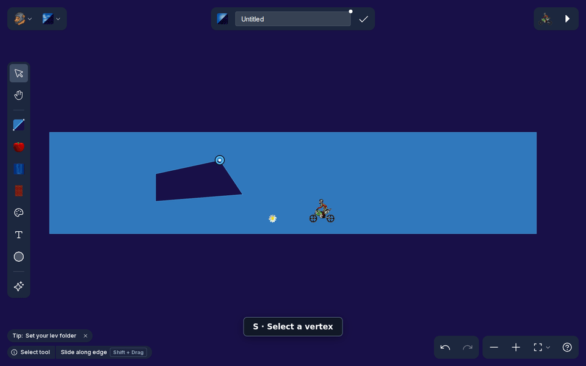
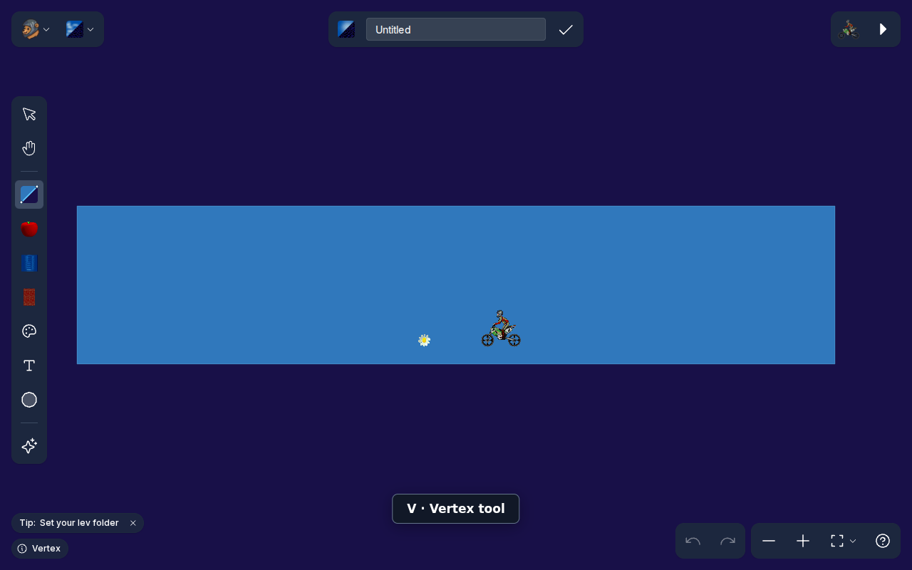
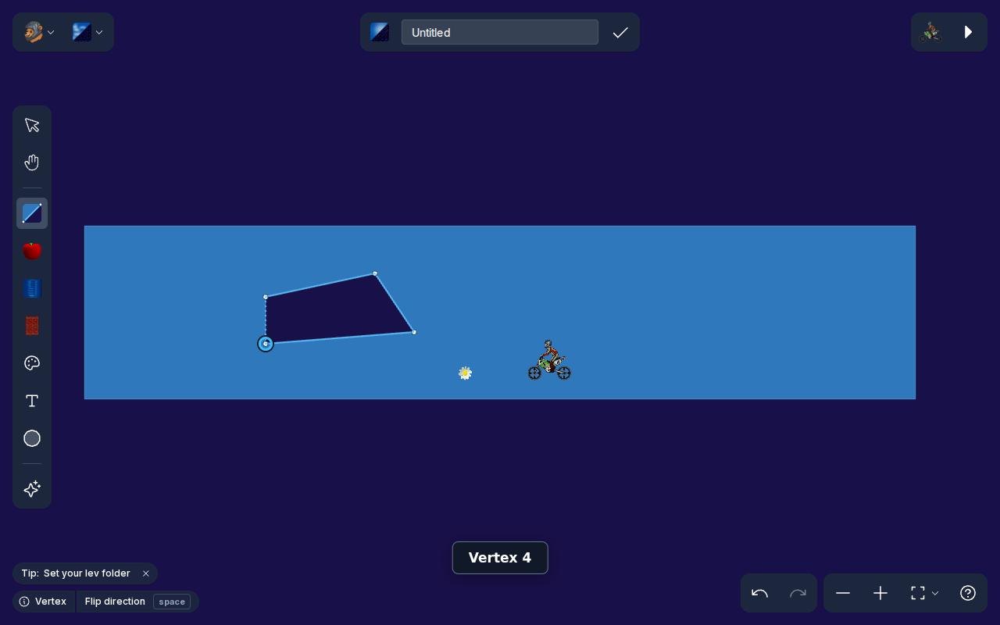
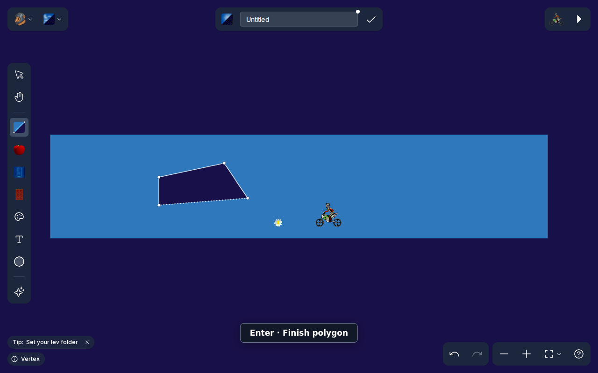

# Bear Editor — visual documentation preview

These are prototype captures from the real editor, presented side by side with
the corresponding written workflow. The GIFs loop automatically; tap an image
to inspect it at full resolution.

## 1. Creating a polygon

## 2. Moving a vertex

## 3. Illustrated walkthrough

**Step 1 — Select the Vertex tool (V).**

**Step 2 — Click to place vertices.**

**Step 3 — Press Enter to finish the polygon.**

The overview and playtest recording are not included because the example level
failed to load correctly in the capture environment.
